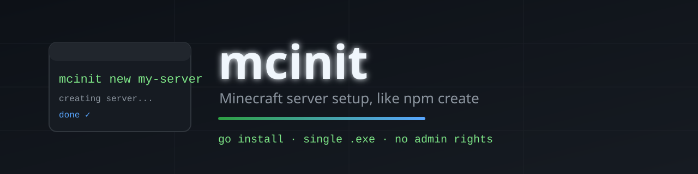

<p align="center">
  
</p>

<p align="center">
  <a href="https://github.com/evnbnet/mcinit/actions/workflows/ci.yml">
    
  </a>
  <a href="https://github.com/evnbnet/mcinit/releases/latest">
    
  </a>
  
  
  <a href="https://github.com/evnbnet/mcinit/stargazers">
    
  </a>
</p>

<p align="center">
  <strong>A single <code>.exe</code> that sets up a Minecraft server on localhost.</strong><br>
  Think <code>npm create</code>, but for servers: interactive by default, with flags for automation.
</p>

<p align="center">
  <code>mcinit new my-server</code>
</p>

---

## ✨ Features

- 🎮 **Interactive by default** — asks for software, version, RAM and folder.
- ⚡ **Fast, direct downloads** — Paper via `fill.papermc.io/v3`, Purpur via `api.purpurmc.org/v2`.
- 🔒 **Always verified** — SHA-256 for Paper, MD5 for Purpur. Nothing half-downloaded reaches the final folder.
- ☕ **Java handled for you** — detects installed Java and installs Temurin with `winget` (falling back to Adoptium's signed MSI).
- 📦 **Smart backups** — `backup`/`restore` zip worlds, configs and plugins, skipping jars, `libraries/`, caches and logs.
- 🧠 **Both version schemes** — understands classic `1.21.11` and year-based `26.3`, which can't be compared as plain semver.

## 📥 Install

```powershell
irm https://github.com/evnbnet/mcinit/releases/latest/download/install.ps1 | iex
```

It installs into `%LOCALAPPDATA%\mcinit\bin` and adds that to the user `PATH`, with no administrator rights. If another terminal cannot find it, close and reopen that terminal.

## 🚀 Usage

```text
mcinit new my-server      create a server
mcinit backup             save the world into backups/
mcinit restore            put a saved world back
```

### `mcinit new`

```text
mcinit new my-server
mcinit new my-server --software purpur --mc 26.3 --ram 8
mcinit new auto --mc latest --accept-eula --yes
```

| Flag | What it does |
|---|---|
| `--software` | `paper` or `purpur` |
| `--mc` | Minecraft version, or `latest` |
| `--ram` | RAM in GB |
| `--dir` | destination folder (defaults to `./<name>`) |
| `--accept-eula` | accept the [Minecraft EULA](https://aka.ms/MinecraftEULA) |
| `--yes` / `-y` | ask nothing; fail if anything is missing |
| `--no-color` | no colors or Unicode glyphs (also honours `NO_COLOR`) |

### `mcinit backup` and `mcinit restore`

```text
mcinit backup                      # from inside the server folder
mcinit backup --dir my-server
mcinit restore                     # pick from a list
mcinit restore --latest --yes      # for scripts
```

Backups are zips in `backups/` next to the server, so moving the server folder moves its history with it. A backup holds the worlds, `server.properties`, the ops/whitelist/ban lists and the whole `plugins/` folder. It leaves out the server jar, `libraries/`, caches and logs — mcinit can download those again, and skipping them took one real backup from 25.8 MB to 625 KB.

`restore` always archives the state it is about to replace first, so restoring the wrong backup is recoverable: the copy is labelled `_pre-restore` and shows up in the next listing. Neither command will touch a running server — a world copied mid-write can contain half-written region files, and one Minecraft has open cannot be replaced at all. `backup --force` overrides the first case; `restore` has no override.

To start the server, from the folder it created:

```powershell
.\start.bat
```

The `.\` is not decoration: PowerShell does not run files from the current directory without it, and in `cmd` it stops the `start` builtin from shadowing the file.

## ⚙️ How it works

- **Paper** through `fill.papermc.io/v3` and **Purpur** through `api.purpurmc.org/v2`, both direct downloads. Spigot is out of scope: BuildTools is slow and fragile.
- **Always verified**: SHA-256 for Paper, MD5 for Purpur (the only digest it publishes). Nothing half-downloaded ever reaches the final folder.
- **Java handled for you**: it detects what is installed and, if nothing fits, installs Temurin with `winget`, falling back to Adoptium's signed MSI. The generated `start.bat` embeds the **absolute** path to `java.exe`, because a freshly installed JRE is not on the PATH of an already-open terminal.
- **Minecraft versions**: it understands both schemes, the classic `1.21.11` and the newer year-based `26.3`, which cannot be compared as plain semver.

| Minecraft | Java |
|---|---|
| 26.1 and newer | 25 |
| 1.20.5 – 1.21.x | 21 |
| 1.17 – 1.20.4 | 17 |
| older | 8 |

## 🛠️ Development

```powershell
go test ./...          # includes checks against the live APIs
go test -short ./...   # offline only, which is what CI runs
go build -o mcinit.exe .
```

The live API checks exist on purpose: Paper already broke compatibility once by retiring `api.papermc.io/v2`, and these are how you find out before users do.

## 🤝 Contributing

Issues and pull requests are welcome! If you hit a bug or want a feature, please open an issue with reproduction steps.

## 📄 License

No license file is included yet. All rights reserved by the author until a license is added.